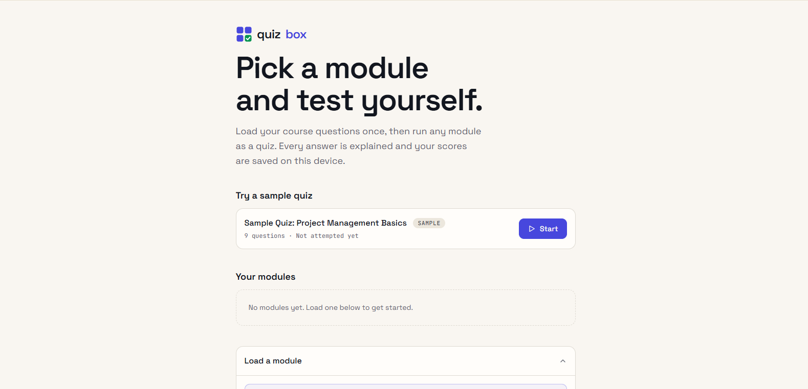

# Quizbox

Quizbox is a quiz app for practising your own questions. Load a set of multiple choice questions from a file, answer them one at a time, read the explanation after each one, and see which ones you missed. It works for any subject. Everything you load is stored in your browser, so there is no account to create and nothing to sync.

**[Live Demo](https://crypticot.github.io/quizbox/)**



---

## Why this exists

Most quiz tools either lock you into their own question banks or ask you to sign up before you can practise. The part that actually helps with revision is small: your own questions, a clear answer after each one, and a list of what you got wrong.

Quizbox sticks to that. The whole app is a single file with no server behind it, so your questions and scores never leave the browser. There is no sign-up, no analytics, and nothing to install. A built-in sample quiz lets you try it before you load anything of your own.

---

## What it does

- **Sample quiz**: a short built-in quiz with easy, medium, and hard questions, so a first visit has something to try. Finishing it shows a card that leads straight to loading your own questions
- **Load your own questions**: pick one or more `.json` files, or paste the JSON into a box. A file with several modules loads them all at once. Loading a module with the same title replaces the old one and keeps its scores
- **Help guide**: a short step-by-step guide shows how to turn questions from your notes, a PDF, or a course platform into the right file using any AI chat. It includes a prompt you can copy, and the module title you type is added to the prompt for you
- **Instant feedback**: after each answer you see whether it was right, the correct answer, and the explanation if the file has one. A progress bar, a running score, and a streak counter stay in view
- **Optional timer**: switch on a limit of 30, 45, 60, 90, or 120 seconds per question. Unanswered questions count as wrong. With the timer off, a stopwatch shows how long you spend on each question
- **Shuffle**: mix the order of the questions each time you start a module, or turn it off to go through them in file order
- **Results**: your percentage, correct and incorrect counts, best streak, average time per question, and a full answer review that shows what you picked, the right answer, and the explanation for each miss
- **Retry missed**: run a quiz made only of the questions you got wrong. Retries are not added to your saved scores
- **Saved scores**: each module remembers your best score, your last score, and how many times you have taken it
- **Backup**: Export backup downloads all your modules as one JSON file, and the Load panel brings it back on any browser or device
- **Keyboard shortcuts**: press A to F (or 1 to 6) to answer, and Enter or the right arrow for the next question
- **Works on phones**: the layout fits narrow screens, follows your system's light or dark setting, and respects reduced-motion settings

---

## How to make a module file

A module is a small JSON file. Each question needs a prompt, a list of 2 to 6 options, and the letter of the correct option. The explanation and category are optional.

```json
{
  "title": "Module 1: Project Fundamentals",
  "questions": [
    {
      "prompt": "Which document formally authorises a project?",
      "options": [
        "Project charter",
        "Work breakdown structure",
        "Risk register",
        "Status report"
      ],
      "answer": "A",
      "explanation": "The project charter formally authorises the project."
    }
  ]
}
```

You do not have to write this by hand. Open the Help section in the app, copy the prompt, paste it into any AI chat with your questions underneath, and save the code block it returns as a `.json` file. If something is wrong with a file, the app tells you which question has the problem.

A 30-question example file is included in [`examples/pm-test-module.json`](examples/pm-test-module.json) if you want to see a larger module.

---

## Tech stack

Built entirely in vanilla HTML, CSS, and JavaScript, in one file. Just open `index.html`.

- No libraries and no build step
- Browser storage (`localStorage`) keeps your modules, scores, and settings on your device
- Google Fonts: Space Grotesk (text) + JetBrains Mono (numbers and labels), with system fonts as the fallback if they cannot load

---

## Running it locally

```bash
git clone https://github.com/crypticot/quizbox.git
cd quizbox
```

Open `index.html` in any modern browser. No dependencies to install, no server required.

---

## A few design decisions worth knowing

**Why questions load from files in the browser.** Quizbox never uploads your questions anywhere. The file you pick is read by the page itself and saved in your own browser. That keeps course material private, and it means the public repository holds only the app, not anyone's questions.

**Why there is an AI prompt in the Help section.** Writing JSON by hand is the slowest part of using a tool like this, and most people already have their questions in a document. The prompt tells the AI to keep your wording, give the answer as one letter, strip labels like "A." from options, and leave out any question that has no answer key instead of guessing. It also splits long sets into parts of 40 questions or fewer, so the reply is not cut off.

**Why shuffle changes the question order but not the options.** The answer in a module file is a letter that points to a position in the option list. Keeping options in the order you wrote them keeps that letter correct and makes the keyboard shortcuts predictable.

**Why Retry missed is not saved.** A retry only contains the questions you already got wrong, so a high score there would say little about the whole module. Only full runs update your best and last scores.

**Why your data lives in the browser, and why Export backup exists.** Keeping data in browser storage is what makes the tool private and account-free. The tradeoff is that storage belongs to one browser on one device, and clearing site data erases it. Export backup gives you a file you control. It holds your modules, so scores and settings start fresh when you load it on a new device.

---

## Built by

**Chidubem Ojukwu** · [Portfolio](https://crypticot.github.io/cotworks-portfolio/) · [LinkedIn](https://linkedin.com/in/ojukwuii)

Created by COTworks. A single-file tool for anyone who wants to practise their own questions, with nothing to sign up for.
